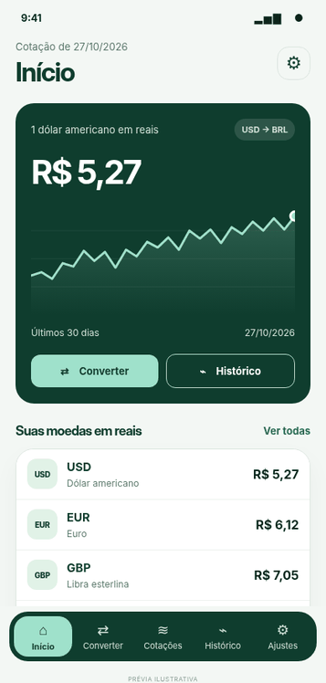

<div align="center">


# currency-converter-app

App mobile do Converter: conversor de moedas, cotações do dia e histórico desde 2000, com tema claro e escuro e funcionando sem conexão.

</div>

O app é feito com React Native e Expo (Expo Go) e consome a [currency-converter-api](https://github.com/aqu1no1/currency-converter-api), que guarda as cotações diárias de bancos centrais sincronizadas da [Frankfurter](https://frankfurter.dev). As respostas ficam salvas no aparelho, então o app continua mostrando as últimas cotações sem internet.

Moedas suportadas: USD, BRL, EUR, GBP, JPY, CAD, AUD, CHF, CNY e ARS. Textos em português, inglês e espanhol, com valores, taxas e datas formatados no idioma ativo.

## Demonstração

<div align="center">
  
</div>

## Stack

<p>
  
  
  
  
  
  
</p>

A lista completa, com o uso de cada tecnologia e as regras de instalação, está em [docs/organizacao-do-projeto.md](docs/organizacao-do-projeto.md#1-stack).

## Documentação

| Página                                                   | O que tem                                                                |
| -------------------------------------------------------- | ------------------------------------------------------------------------ |
| [Como rodar o app](docs/como-rodar.md)                   | Variantes beta e production, Expo Go, builds com EAS e problemas comuns  |
| [Organização do projeto](docs/organizacao-do-projeto.md) | Stack, pastas, rotas, convenções, tema, traduções e testes               |
| [Testes](docs/testes.md)                                 | Como os testes funcionam, onde ficam, como rodar e como escrever um novo |
| [CI e releases](docs/CI.md)                              | GitHub Actions, CHANGELOG e como lançar uma versão                       |
| [CHANGELOG](CHANGELOG.md)                                | O que mudou em cada versão                                               |

## Como rodar

### Pré-requisitos

- Node.js 24
- pnpm 12 (versão no campo `packageManager` do `package.json`; `corepack enable` já disponibiliza)
- O app **Expo Go** no celular, na mesma rede Wi-Fi da máquina
- A [currency-converter-api](https://github.com/aqu1no1/currency-converter-api) rodando

### Passo a passo

```bash
# 1. Variáveis de ambiente
cp .env.example .env   # coloque o IP da máquina em EXPO_PUBLIC_API_URL

# 2. Dependências
pnpm install

# 3. App (variante beta)
pnpm start:beta -c     # escaneie o QR code com o Expo Go
```

O celular não acessa `localhost`: use o IP da máquina na rede, como `http://192.168.0.10:3000`. Se o celular não alcançar a máquina, `pnpm start:tunnel` sobe o Expo por um túnel. As variantes, os builds com EAS e os problemas comuns estão em [docs/como-rodar.md](docs/como-rodar.md).

### Variáveis de ambiente

| Variável              | Descrição                               |
| --------------------- | --------------------------------------- |
| `EXPO_PUBLIC_API_URL` | URL da API, com o IP da máquina na rede |

Tudo que começa com `EXPO_PUBLIC_` fica visível no app, então nada secreto vai ali.

### Instalando libs

- Lib com código nativo: `pnpm expo install <lib>`
- Lib só JavaScript: `pnpm add <lib>` (desenvolvimento: `pnpm add -D <lib>`)
- Nunca usar npm ou yarn: o projeto só tem o `pnpm-lock.yaml`

## Telas

| Rota (Expo Router)        | Tela           | O que tem                                                                                          |
| ------------------------- | -------------- | -------------------------------------------------------------------------------------------------- |
| `/`                       | Boas-vindas    | Apresentação no primeiro acesso, com "Começar" e "Converter agora"                                 |
| `/onboarding`             | Onboarding 1/3 | Uma conta, dez moedas                                                                              |
| `/onboarding/history`     | Onboarding 2/3 | Veja como o câmbio mudou                                                                           |
| `/onboarding/preferences` | Onboarding 3/3 | Moeda principal e idioma                                                                           |
| `/home`                   | Início         | Dólar em reais com a tendência de 30 dias, suas moedas na moeda principal e a última sincronização |
| `/converter`              | Converter      | Teclado numérico e o valor em cada moeda; tocar numa moeda converte a partir dela                  |
| `/rates`                  | Cotações       | Moeda base à escolha e quanto ela vale em cada moeda; a linha abre o histórico                     |
| `/history`                | Histórico      | Gráfico do par em 7 dias, 30 dias ou 1 ano, com variação, início, mínima, máxima e mais recente    |
| `/settings`               | Ajustes        | Tema, idioma, moeda principal e as últimas execuções da sincronização                              |

As abas ficam em `src/app/(tabs)/` e o onboarding em `src/app/onboarding/`.

### Estados de erro

Se há dados salvos, a tela continua e mostra só um aviso; o estado de erro ocupa a tela só quando não há nada para mostrar.

| Estado                                | Quando aparece                                       |
| ------------------------------------- | ---------------------------------------------------- |
| Sem conexão                           | O aparelho está offline (com ou sem cotações salvas) |
| API indisponível                      | Erro de rede, timeout ou 5xx                         |
| Cotações a caminho                    | A API responde `503` antes da primeira sincronização |
| Atualização falhou                    | A última sincronização falhou; aviso na tela Início  |
| Sem cotações nesse período            | O histórico do par no período veio vazio             |
| Algo deu errado / Tela não encontrada | Erro inesperado numa tela ou rota que não existe     |

## Scripts

| Script                                            | O que faz                                                       |
| ------------------------------------------------- | --------------------------------------------------------------- |
| `pnpm start:beta`                                 | Expo na variante beta (use `-c` para limpar o cache)            |
| `pnpm start`                                      | Expo na variante production                                     |
| `pnpm start:tunnel`                               | Expo por túnel, quando o celular não alcança a máquina na rede  |
| `pnpm android:beta` / `pnpm ios:beta`             | Abre direto no emulador Android ou no simulador iOS             |
| `pnpm build:dev:beta` / `pnpm build:preview:beta` | Development build e APK de preview com EAS                      |
| `pnpm build:android`                              | Build de produção com EAS                                       |
| `pnpm lint` / `pnpm lint:fix`                     | Lint com oxlint                                                 |
| `pnpm format` / `pnpm format:check`               | Formatação com oxfmt                                            |
| `pnpm typecheck`                                  | Checagem de tipos                                               |
| `pnpm test` / `pnpm test:watch`                   | Testes com Jest                                                 |
| `pnpm test:cov`                                   | Testes com cobertura                                            |
| `pnpm doctor`                                     | Confere as versões das libs com o `expo-doctor`                 |
| `pnpm pr`                                         | Lint, formatação, typecheck, testes com cobertura e doctor (CI) |

## Testes

```bash
pnpm test         # todos os testes, no Node: sem celular, rede nem API
pnpm test:cov     # com cobertura (relatório em coverage/)
```

| Tipo                            | Testes | O que cobre                                                                             |
| ------------------------------- | ------ | --------------------------------------------------------------------------------------- |
| Unitário (`test/unit`)          | 96     | Utils (formatação, conversão, histórico, sync), services, hooks, preferências e i18n    |
| Componentes (`test/components`) | 88     | Componentes compartilhados: logo, botões, teclado, gráficos, listas e estados de erro   |
| Integração (`test/integration`) | 43     | Telas inteiras com a API simulada: converter, cotações, histórico, ajustes e onboarding |

Os testes usam Jest com o preset `jest-expo` e a Testing Library, com os módulos nativos simulados. O guia completo está em [docs/testes.md](docs/testes.md).

## Estrutura

```
src/
├── app/           # rotas (expo-router): cada arquivo é uma tela
├── components/    # componentes compartilhados
├── hooks/         # hooks de dados (TanStack Query) e de UI
├── services/      # ApiService + uma classe por recurso da API
├── contexts/      # contexts de domínio (preferências)
├── theme/         # ThemeProvider + useTheme
├── constants/     # tema, storage, tempo e sincronização
├── dtos/          # schemas Zod das respostas da API
├── models/        # modelos de domínio
├── interfaces/    # interfaces e classes genéricas
├── enums/         # enums
├── utils/         # funções utilitárias
├── lib/           # configuração de libs (react-query, i18n)
├── locales/       # pt-BR, en e es
└── assets/        # imagens e logo
types/             # declarações globais (.d.ts)
test/              # unit, components, integration, setup, fixtures, utils
```

Cada pasta tem um alias com o mesmo nome (`@components`, `@services`, `@constants`...). Sempre importe pelo alias:

```ts
import { TIME_IN_MS } from '@constants/time.constants';
```

Os detalhes das pastas, das rotas e das convenções estão em [docs/organizacao-do-projeto.md](docs/organizacao-do-projeto.md).

## Planejamento no Linear

O app foi planejado e acompanhado no Linear: [App Converter](https://linear.app/api-converter/project/app-converter-a96e35f09424). Os links abrem só para quem tem acesso ao workspace.

**Tasks, por milestone**

| Milestone              | Task                                                                                                                                                                                      |
| ---------------------- | ----------------------------------------------------------------------------------------------------------------------------------------------------------------------------------------- |
| 1. Setup e organização | [API-28](https://linear.app/api-converter/issue/API-28/criar-o-projeto-com-expo-e-pnpm-e-montar-a-estrutura-de-pastas) Criar o projeto com Expo e pnpm e montar a estrutura de pastas     |
|                        | [API-29](https://linear.app/api-converter/issue/API-29/configurar-oxlint-oxfmt-jest-ci-pipeline-de-release-e-template-de-pr) Configurar oxlint, oxfmt, Jest, CI, release e template de PR |
| 2. Base do app         | [API-30](https://linear.app/api-converter/issue/API-30/tema-claro-e-escuro-com-themeprovider-e-usetheme) Tema claro e escuro com ThemeProvider e useTheme                                 |
|                        | [API-31](https://linear.app/api-converter/issue/API-31/traducoes-com-i18next-em-pt-br-en-e-es) Traduções com i18next em pt-BR, en e es                                                    |
|                        | [API-32](https://linear.app/api-converter/issue/API-32/camada-de-api-apiservice-services-dtos-e-hooks-com-tanstack-query) Camada de API: ApiService, services, DTOs e hooks               |
|                        | [API-33](https://linear.app/api-converter/issue/API-33/componentes-compartilhados-do-design) Componentes compartilhados do design                                                         |
|                        | [API-34](https://linear.app/api-converter/issue/API-34/layout-raiz-e-navegacao-por-abas) Layout raiz e navegação por abas                                                                 |
|                        | [API-41](https://linear.app/api-converter/issue/API-41/assets-do-app-icone-splash-logo-e-icones-de-interface) Assets do app: ícone, splash, logo e ícones de interface                    |
|                        | [API-45](https://linear.app/api-converter/issue/API-45/builds-do-app-com-eas-development-build-e-apk-de-preview-beta) Builds com EAS: development build e APK de preview (beta)           |
| 3. Telas do app        | [API-35](https://linear.app/api-converter/issue/API-35/tela-de-boas-vindas) Tela de Boas-vindas                                                                                           |
|                        | [API-36](https://linear.app/api-converter/issue/API-36/tela-inicio) Tela Início                                                                                                           |
|                        | [API-37](https://linear.app/api-converter/issue/API-37/tela-converter) Tela Converter                                                                                                     |
|                        | [API-38](https://linear.app/api-converter/issue/API-38/tela-cotacoes) Tela Cotações                                                                                                       |
|                        | [API-39](https://linear.app/api-converter/issue/API-39/tela-historico) Tela Histórico                                                                                                     |
|                        | [API-40](https://linear.app/api-converter/issue/API-40/tela-ajustes) Tela Ajustes                                                                                                         |
|                        | [API-42](https://linear.app/api-converter/issue/API-42/onboarding-13-uma-conta-dez-moedas) Onboarding 1/3: Uma conta, dez moedas                                                          |
|                        | [API-43](https://linear.app/api-converter/issue/API-43/onboarding-23-veja-como-o-cambio-mudou) Onboarding 2/3: Veja como o câmbio mudou                                                   |
|                        | [API-44](https://linear.app/api-converter/issue/API-44/onboarding-33-do-seu-jeito-moeda-principal-e-idioma) Onboarding 3/3: Do seu jeito (moeda principal e idioma)                       |
| Sem milestone          | [API-46](https://linear.app/api-converter/issue/API-46/erros-base-de-tratamento-errorstate-e-statusbanner) Erros: base de tratamento, ErrorState e StatusBanner                           |
|                        | [API-47](https://linear.app/api-converter/issue/API-47/erros-sem-conexao-com-cotacoes-salvas-e-sem-dados) Erros: sem conexão (com cotações salvas e sem dados)                            |
|                        | [API-48](https://linear.app/api-converter/issue/API-48/erros-api-indisponivel-cotacoes-ainda-nao-disponiveis-e-historico) Erros: API indisponível, cotações a caminho e histórico vazio   |
|                        | [API-49](https://linear.app/api-converter/issue/API-49/erros-aviso-de-atualizacao-que-falhou-na-inicio) Erros: aviso de atualização que falhou na Início                                  |
|                        | [API-50](https://linear.app/api-converter/issue/API-50/erros-telas-cheias-algo-deu-errado-e-tela-nao-encontrada) Erros: telas "Algo deu errado" e "Tela não encontrada"                   |
|                        | [API-53](https://linear.app/api-converter/issue/API-53/horario-da-sincronizacao-no-inicio-em-fuso-local-com-hojeontemdata) Horário da sincronização no Início em fuso local               |
|                        | [API-52](https://linear.app/api-converter/issue/API-52/publicar-o-app-no-f-droid) Publicar o app no F-Droid                                                                               |

Cada task tem contexto, o que fazer e critérios de aceite.

## Fonte dos dados

As cotações vêm da [currency-converter-api](https://github.com/aqu1no1/currency-converter-api), que sincroniza todos os dias da [Frankfurter v2](https://frankfurter.dev): cotações de bancos centrais e fontes oficiais, com histórico desde 2000. São taxas médias de mercado, só para referência: não incluem spread nem tarifas.
